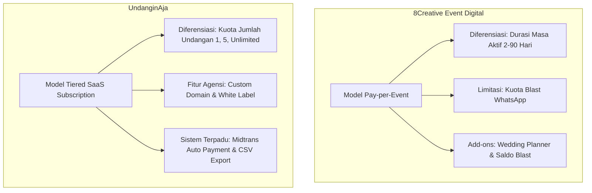
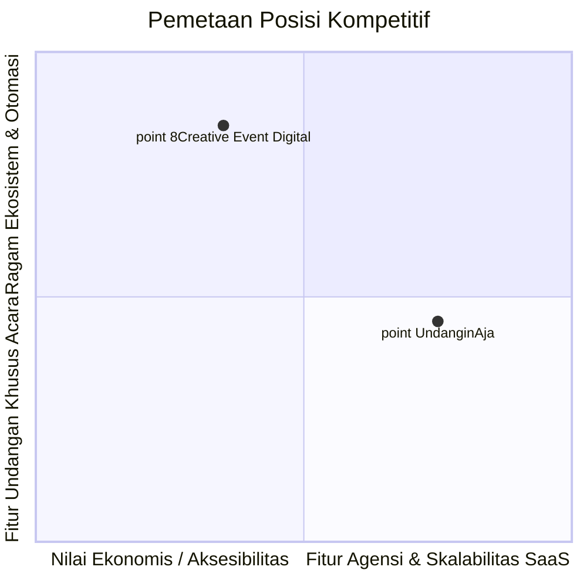

# Dokumentasi Analisis Komparasi Paket & Fitur: 8Creative Event Digital vs UndanginAja

Dokumen ini memuat analisis mendalam dan perbandingan komprehensif antara model paket, penawaran harga, kapabilitas fitur, dan strategi bisnis antara platform kompetitor **8Creative Event Digital** dengan platform **UndanginAja**.

---

## 1. Ringkasan Eksekutif (Executive Summary)

Terdapat perbedaan mendasar dalam **filosofi bisnis dan arsitektur model SaaS** antara kedua platform:

1. **8Creative Event Digital (Model Pay-per-Event B2C)**:
   - Menggunakan pendekatan *event-centric* dengan diferensiasi utama pada **durasi masa aktif undangan** (2 hari, 10 hari, 30 hari, 90 hari) dan **kuota blast WhatsApp otomatis**.
   - Sangat fokus pada pengantin perorangan (B2C) dengan fitur viralitas dan interaksi hari-H (*Guest on Screen*, *Voice Comment*, *Love Story*, *Smart WhatsApp Blast*).
   - Menjual produk turunan melalui modul **Add-on** (*Wedding Planner* Rp79.000 sekali bayar & *Top-up Credit WhatsApp Blast*).

2. **UndanginAja (Model Multi-Tier SaaS Subscription B2C & B2B/Agency)**:
   - Menggunakan pendekatan *account-subscription* berbasis **kuota jumlah undangan** (1, 5, hingga unlimited), akses template, dan fitur agensi/reseller ([Custom Domain](file:///c:/laragon/www/UndanginAja/database/seeders/PlanSeeder.php#L36), [White Label](file:///c:/laragon/www/UndanginAja/database/seeders/PlanSeeder.php#L53), [Analytics](file:///c:/laragon/www/UndanginAja/database/seeders/PlanSeeder.php#L37)).
   - Memiliki arsitektur berlangganan 30 hari otomatis terintegrasi gateway [Midtrans Snap](file:///c:/laragon/www/UndanginAja/app/Http/Controllers/TransactionController.php#L65).
   - Sangat fleksibel untuk Wedding Organizer (WO), Event Organizer (EO), agensi, maupun pasangan yang mengadakan beberapa sesi acara berbeda.

---

## 2. Matriks Perbandingan Paket & Struktur Harga

| Dimensi Evaluasi | 8Creative Event Digital | UndanginAja | Analisis & Komparasi |
| :--- | :--- | :--- | :--- |
| **Model Penetapan Harga** | Pay-per-Event (per undangan) | SaaS Subscription (per akun / periode 30 hari) | 8Creative fokus pada sekali beli per acara, UndanginAja fokus pada recurring & multi-undangan. |
| **Paket Gratis (Free)** | **Rp0** (Masa aktif 2 Hari, 10 Tamu Blast) | **Rp0** ([1 Undangan, Template Gratis, RSVP Basic](file:///c:/laragon/www/UndanginAja/database/seeders/PlanSeeder.php#L17-L27)) | UndanginAja tidak membatasi masa aktif menjadi 2 hari yang terlalu singkat, memberikan pengalaman coba yang lebih leluasa bagi pengguna. |
| **Tier Pemula / Silver** | **Rp35.000** *(Normal Rp50.000)* Aktif 10 Hari, 50 Blast WA | *(Belum ada tier setara Rp35rb, langsung ke Pro Rp99rb)* | 8Creative memiliki titik masuk (*entry barrier*) yang sangat murah untuk pengantin yang hanya butuh 1 undangan aktif sebentar. |
| **Tier Menengah (Gold / Pro)** | **Rp75.000** *(Normal Rp150.000)* Aktif 30 Hari, 100 Blast WA, Amplop Digital | **Rp99.000** [5 Undangan, Semua Template, RSVP Unlimited, Custom Domain, Analytics](file:///c:/laragon/www/UndanginAja/database/seeders/PlanSeeder.php#L29-L41) | Paket Pro UndanginAja jauh lebih bernilai (*higher value*) karena memberikan **5 undangan** dan **Custom Domain**, bukan hanya 1 undangan. |
| **Tier Tertinggi (Platinum / Business)** | **Rp100.000** *(Normal Rp200.000)* Aktif 90 Hari, 200 Blast WA, Love Story, Dresscode | **Rp249.000** [Unlimited Undangan (999), White Label, Priority Support](file:///c:/laragon/www/UndanginAja/database/seeders/PlanSeeder.php#L43-L57) | Paket Business UndanginAja ditargetkan untuk Vendor/WO dengan fitur **White Label**, sedangkan Platinum 8Creative adalah paket maksimal untuk pengantin perorangan. |
| **Strategi Diskon & Promosi** | Menggunakan teknik harga coret agresif (Rp50k &rarr; Rp35k, Rp150k &rarr; Rp75k, Rp200k &rarr; Rp100k) | Menampilkan harga flat bersih ([Rp0, Rp99.000, Rp249.000](file:///c:/laragon/www/UndanginAja/database/seeders/PlanSeeder.php)) | Pendekatan psikologis harga 8Creative menciptakan ilusi urgensi dan diskon besar (50%). |
| **Monetisasi Tambahan (Add-ons)** | 1. **Wedding Planner**: Rp79.000 (Akses selamanya) 2. **Top-up Saldo WhatsApp Blast** | Belum ada sistem add-on terpisah | 8Creative berhasil menciptakan sumber pendapatan sekunder (*cross-selling*) sebelum hari H. |

---

## 3. Matriks Komparasi Fitur Komprehensif

Berikut perbandingan detail ketersediaan fitur antara 8Creative Event Digital dan codebase [UndanginAja](file:///c:/laragon/www/UndanginAja):

| Kategori Fitur | Fitur Spesifik | 8Creative Event Digital | UndanginAja | Status di UndanginAja & Penjelasan Teknis |
| :--- | :--- | :---: | :---: | :--- |
| **Durasi & Kuota** | Masa Aktif Undangan | Dibatasi per paket (2, 10, 30, 90 hari) | 30 Hari per siklus bayar / Tanpa batas kedaluwarsa ketat di database | Diatur di [TransactionController.php](file:///c:/laragon/www/UndanginAja/app/Http/Controllers/TransactionController.php#L138) (`addDays(30)`). |
| | Kuota Jumlah Undangan | 1 Undangan per transaksi | 1 (Free), 5 (Pro), Unlimited (Business) | Diatur di [Plan.php](file:///c:/laragon/www/UndanginAja/app/Models/Plan.php#L26) & [User.php](file:///c:/laragon/www/UndanginAja/app/Models/User.php#L87-L110). |
| **Buku Tamu & RSVP** | RSVP Konfirmasi Kehadiran | Ya (Hadir / Tidak) | Ya ([Hadir, Tidak Hadir, Ragu](file:///c:/laragon/www/UndanginAja/resources/views/public/invitation.blade.php#L210-L234)) | Didukung Enum [GuestAttendance.php](file:///c:/laragon/www/UndanginAja/database/migrations/2026_10_12_043436_create_guests_table.php#L20). |
| | Doa & Ucapan Tamu | Ya (Text & Voice) | Ya (Text Real-Time) | Tampil langsung di [invitation.blade.php](file:///c:/laragon/www/UndanginAja/resources/views/public/invitation.blade.php#L285-L306). |
| | Voice Comment (Audio) | Ya (Semua paket) | Belum Ada | 8Creative memungkinkan tamu merekam suara ucapan. |
| | Ekspor Data Tamu (CSV/Excel) | Ya | Ya (CSV Terpadu) | Fitur siap pakai di [GuestController.php::export](file:///c:/laragon/www/UndanginAja/app/Http/Controllers/GuestController.php#L63-L107). |
| | Guest on Screen (Check-in Hari H) | Ya (Semua paket) | Belum Ada | Layar monitor tamu hadir saat resepsi hari-H. |
| **WhatsApp Integration** | Share Link ke WhatsApp | Ya | Ya | Tombol share instan di [invitation.blade.php](file:///c:/laragon/www/UndanginAja/resources/views/public/invitation.blade.php#L315-L322). |
| | Custom Preview WhatsApp (OG Tags) | Mulai Paket Silver | Ya (Semua Paket) | Sudah diimplementasikan melalui OpenGraph di [invitation.blade.php](file:///c:/laragon/www/UndanginAja/resources/views/public/invitation.blade.php#L11-L16). |
| | Auto Blast Smart WhatsApp API | Ya (10 - 200 Tamu + Top Up) | Belum Ada | Pengiriman otomatis WA API dengan template personal nama tamu. |
| **Desain & Tema** | Pilihan Desain / Tema | 160+ Pilihan Tema | 6 Tema (Kategori: Elegant, Rustic, Modern, Minimalist) | Dikelola di [TemplateSeeder.php](file:///c:/laragon/www/UndanginAja/database/seeders/TemplateSeeder.php) & [TemplateController.php](file:///c:/laragon/www/UndanginAja/app/Http/Controllers/TemplateController.php). |
| | Custom Font Tema | Mulai Paket Gold | Belum Tersedia di Form UI | Font saat ini ditentukan oleh CSS template (Playfair & Figtree). |
| **Detail Acara & Personalisasi** | Multi Acara (Akad & Resepsi) | Dibatasi: 1 acara (Free), 2 (Silver/Gold), 3 (Platinum) | Ya (Akad, Resepsi, & Waktu) | Dikelola fleksibel via `theme_config` di [edit.blade.php](file:///c:/laragon/www/UndanginAja/resources/views/invitations/edit.blade.php#L332-L349). |
| | Google Maps Navigasi | Ya (Semua paket) | Ya (Semua paket) | Tersedia di form [StoreInvitationRequest.php](file:///c:/laragon/www/UndanginAja/app/Http/Requests/StoreInvitationRequest.php#L32). |
| | Countdown Acara | Ya (Semua paket) | Belum Ada Widget Khusus | Di UndanginAja baru menampilkan teks tanggal & jam acara. |
| | Galeri Foto | Dibatasi: 3 foto (Free/Silver), 6 (Gold), 9 (Platinum) | Fleksibel via Relasi Galeri | Didukung tabel [invitation_galleries](file:///c:/laragon/www/UndanginAja/database/migrations/2026_10_12_043438_create_invitation_galleries_table.php). |
| | Petunjuk Busana (Dresscode) | Hanya Paket Platinum | Ya (Tersedia di Pengaturan) | Sudah didukung via `theme_config['dress_code_desc']` di [edit.blade.php](file:///c:/laragon/www/UndanginAja/resources/views/invitations/edit.blade.php#L345). |
| | Love Story Timeline | Hanya Paket Platinum | Belum Ada Section Khusus | Belum tersedia input perjalanan cinta mempelai di UI. |
| | Detail Nama Orang Tua & Urutan | Ya | Ya | Sangat lengkap di [edit.blade.php](file:///c:/laragon/www/UndanginAja/resources/views/invitations/edit.blade.php#L284-L330). |
| **Media & Hadiah** | Musik Latar (Background Music) | 1 Lagu (Free), 900+ Pilihan (Silver+) | Custom Audio MP3 URL | Kolom `audio_url` di [edit.blade.php](file:///c:/laragon/www/UndanginAja/resources/views/invitations/edit.blade.php#L374). |
| | Link Live Streaming (YT/IG/TikTok)| Mulai Paket Silver | Belum Disediakan Khusus | Belum ada input dan embed player live streaming. |
| | Amplop Digital / Rekening Hadiah | Mulai Paket Gold | Ya (Semua Paket / Pengaturan Lanjutan) | Sudah didukung di [InvitationController.php](file:///c:/laragon/www/UndanginAja/app/Http/Controllers/InvitationController.php#L112-L120) & [edit.blade.php](file:///c:/laragon/www/UndanginAja/resources/views/invitations/edit.blade.php#L350-L367). |
| **Fitur Bisnis / Enterprise** | Custom Domain | Tidak Ada | Ya (Pro & Business) | Dicantumkan pada paket langganan UndanginAja. |
| | White Label Branding | Tidak Ada | Ya (Paket Business) | Menghilangkan footer branding platform untuk agensi/reseller. |
| | Otomasi Pembayaran | Gateway Lokal | Midtrans Snap Integration | Webhook terintegrasi di [TransactionController.php](file:///c:/laragon/www/UndanginAja/app/Http/Controllers/TransactionController.php#L85-L121). |

---

## 4. Analisis SWOT & Posisi Kompetitif

### A. 8Creative Event Digital
- **Kekuatan (Strengths)**:
  - Fitur interaksi hari-H sangat kuat (*Guest on Screen* & *Voice Comment*).
  - Integrasi WhatsApp Blast otomatis membuat pengantin tidak perlu mengirim manual satu per satu.
  - Pustaka aset sangat banyak (160+ tema, 900+ musik).
  - Ekosistem produk sekunder cerdas dengan modul **Wedding Planner** seharga Rp79.000.
  - Strategi penetapan harga psikologis yang menarik bagi konsumen retail/pasangan pengantin.
- **Kelemahan (Weaknesses)**:
  - Batasan masa aktif undangan sangat ketat (2 s/d 90 hari) sehingga kenangan undangan cepat kedaluwarsa.
  - Tidak memiliki orientasi pasar B2B / Wedding Organizer (tidak ada paket white label, reseller, atau multi-undangan).
  - Struktur harga add-on bisa terkesan membebani jika pengantin memiliki daftar tamu sangat banyak.

### B. UndanginAja
- **Kekuatan (Strengths)**:
  - Fondasi arsitektur SaaS yang sangat solid, rapi, dan modern (Laravel 12, PHP 8.4, Tailwind CSS, Alpine.js).
  - Kuota multi-undangan ([5 undangan di Pro](file:///c:/laragon/www/UndanginAja/database/seeders/PlanSeeder.php#L39), [unlimited di Business](file:///c:/laragon/www/UndanginAja/database/seeders/PlanSeeder.php#L55)) sangat menarik bagi Wedding Organizer dan fotografer pernikahan untuk dijadikan ladang bisnis sampingan (*reselling*).
  - Fitur data tamu sangat bersih dengan dukungan ekspor [CSV spreadsheet langsung](file:///c:/laragon/www/UndanginAja/app/Http/Controllers/GuestController.php#L63).
  - Alur pembayaran otomatis dengan [Midtrans Snap](file:///c:/laragon/www/UndanginAja/app/Http/Controllers/TransactionController.php#L65) yang aman dan teruji di Indonesia (QRIS, VA, E-Wallet).
- **Kelemahan & Area Peluang (Gaps to Address)**:
  - Belum memiliki engine **WhatsApp Auto Blast** (saat ini tamu hanya dibagikan link secara manual).
  - Belum memiliki fitur live check-in (**Guest on Screen**) di lokasi resepsi.
  - Belum ada widget **Countdown Timer** interaktif di halaman publik undangan.
  - Fitur **Love Story**, **Live Streaming Embed**, dan **Pustaka Musik Pilihan** belum diimplementasikan di template publik.
  - Jumlah tema template masih 6 buah, perlu ditingkatkan secara bertahap.

---

## 5. Rekomendasi Roadmap Strategis untuk UndanginAja

Berdasarkan hasil analisis komparasi di atas, berikut adalah langkah-langkah strategis yang direkomendasikan untuk meningkatkan daya saing UndanginAja:

### Tahap 1: Peningkatan Fitur Cepat (Quick Wins - Frontend & Undangan Publik)
1. **Widget Countdown Timer Interaktif**:
   - Menambahkan countdown dinamis (Hari, Jam, Menit, Detik) menuju waktu akad/resepsi pada [public/invitation.blade.php](file:///c:/laragon/www/UndanginAja/resources/views/public/invitation.blade.php).
2. **Section Perjalanan Cinta (Love Story)**:
   - Menambahkan skema input di [theme_config](file:///c:/laragon/www/UndanginAja/database/migrations/2026_10_20_061611_add_theme_config_to_invitations_table.php) untuk timeline cerita (Pertama Bertemu, Lamaran, Menuju Pelaminan).
3. **Embed Live Streaming**:
   - Menambahkan kolom input URL YouTube Live / Instagram / TikTok Live di form edit undangan dan menampilkannya dalam banner khusus di halaman publik.
4. **Pemutar Musik dengan Pilihan Lagu Bawaan**:
   - Menyediakan pilihan lagu romantis bebas royalti langsung di formulir, di samping opsi memasukkan custom URL audio MP3.

### Tahap 2: Integrasi Otomasi & Fitur Unggulan (Core SaaS Value)
1. **Engine WhatsApp Blast dengan Sistem Kuota / Saldo**:
   - Mengintegrasikan gateway WhatsApp (seperti Fonnte, Wablas, atau gateway berbasis Baileys).
   - Memberikan kuota blast gratis per paket (misal: Free: 10 pesan, Pro: 150 pesan, Business: 500 pesan), serta opsi top-up saldo WhatsApp.
2. **Fitur Guest on Screen (QR / Check-in Tamu Hari H)**:
   - Membuat halaman khusus (`/undangan/{slug}/guest-screen`) yang menampilkan nama tamu yang baru tiba secara otomatis di proyektor/layar resepsi.
3. **Voice Wishes (Pesan Suara Tamu)**:
   - Mengizinkan tamu merekam audio pendek (voice note) saat mengisi formulir RSVP menggunakan browser MediaRecorder API.

### Tahap 3: Strategi Monetisasi & Restrukturisasi Paket
1. **Model Hibrida (Per Acara + Langganan Agensi)**:
   - Mempertahankan paket **Pro & Business** untuk Wedding Organizer dan Reseller.
   - Menambahkan opsi pembelian **Paket Single Event (B2C)** bagi pasangan yang hanya membutuhkan 1 undangan tanpa langganan berulang (misal: Paket Silver Rp49.000 / event).
2. **Pengembangan Modul Add-on "Wedding Planner"**:
   - Membangun fitur manajemen persiapan pernikahan (Checklist to-do, anggaran biaya/budgeting, kalender persiapan, dan catatan vendor) sebagai add-on upsell sekali bayar.

---
*Dokumen ini dibuat secara otomatis sebagai referensi analisis produk dan roadmap pengembangan sistem UndanginAja.*

---
Hasil analisis perbandingan komprehensif antara paket & fitur 8Creative Event Digital dan UndanginAja telah selesai disusun dan didokumentasikan secara detail.

Dokumentasi lengkap dapat Anda tinjau pada artifact serta file proyek berikut:

File Dokumentasi Proyek: 

ANALISIS_KOMPARASI_PAKET_FITUR.md
Artifact: 
analisis_komparasi_paket_fitur.md
Poin Kunci & Keputusan Strategis yang Perlu Ditentukan
Strategi Model Bisnis & Harga:

Saat ini 

UndanginAja
 menggunakan model SaaS Multi-Undangan (Pro: 5 undangan, Business: Unlimited) yang sangat kuat untuk segmen Wedding Organizer / Reseller.
Apakah Anda ingin mempertahankan model ini, atau menambahkan opsi Paket Retail / Single Event (B2C) murah (misal: Rp35.000–Rp49.000 per 1 acara aktif 30 hari) untuk bersaing langsung dengan paket Silver/Gold 8Creative?
Prioritas Fitur Diferensiasi Berikutnya:

Opsi A (Quick Wins di Undangan): Menambahkan widget Countdown Timer, section Love Story, dan Embed Live Streaming (YouTube/IG/TikTok) di template undangan publik 

invitation.blade.php
.
Opsi B (Otomasi WhatsApp Blast): Mengintegrasikan gateway WhatsApp (Fonnte/Wablas) untuk auto-blast nama tamu secara personal beserta sistem kuota pesan.
Opsi C (Interaksi Hari-H): Membangun modul layar resepsi Guest on Screen (check-in tamu real-time di layar proyektor).
Opsi D (Add-on Wedding Planner): Mengembangkan modul checklist persiapan pernikahan dan kalkulator anggaran.
