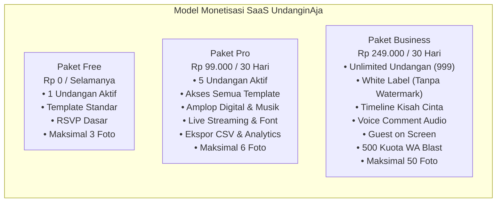
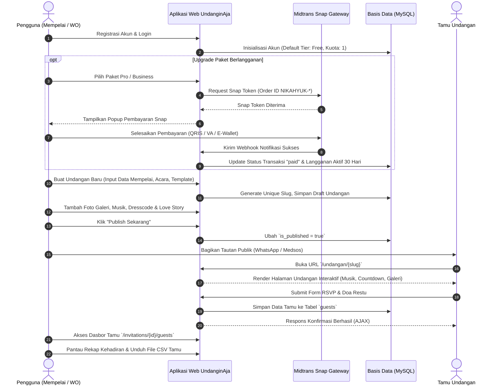
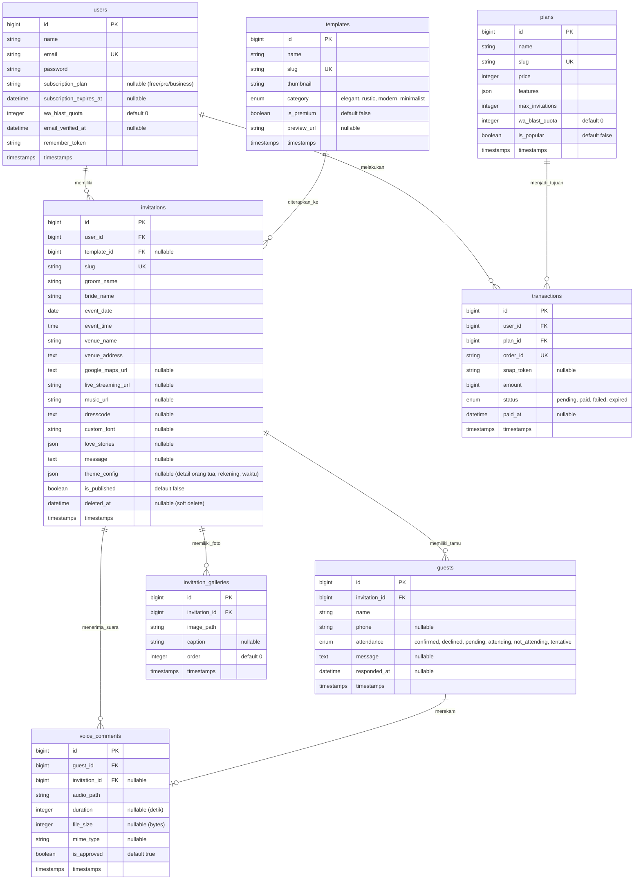
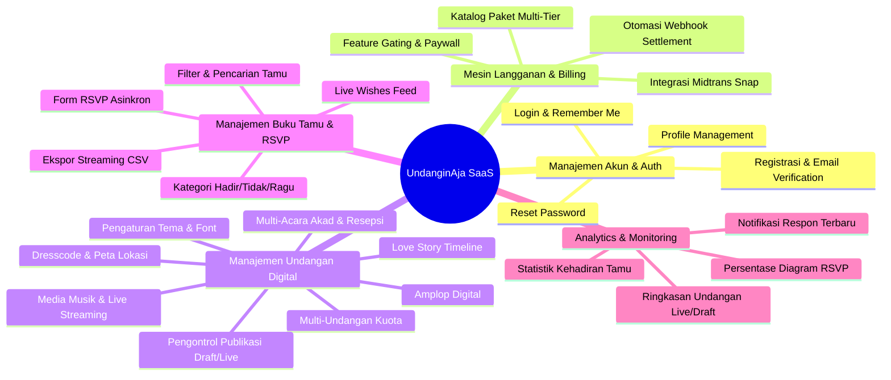
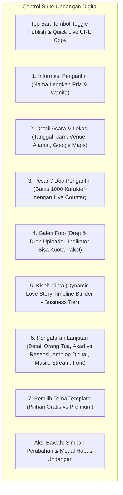

# Dokumentasi Komprehensif Proyek UndanginAja
**Platform Software-as-a-Service (SaaS) Pembuatan & Pengelolaan Undangan Digital Interaktif**

---

## Daftar Isi
1. [Ringkasan Eksekutif & Profil Platform](#1-ringkasan-eksekutif--profil-platform)
2. [Business Flow & Model Bisnis SaaS](#2-business-flow--model-bisnis-saas)
   - [2.1 Model Langganan Multi-Tier (Tiered Subscription)](#21-model-langganan-multi-tier-tiered-subscription)
   - [2.2 Matriks Hak Akses & Pembagian Fitur Antar Paket](#22-matriks-hak-akses--pembagian-fitur-antar-paket)
   - [2.3 Alur Bisnis Pengguna (User Journey)](#23-alur-bisnis-pengguna-user-journey)
   - [2.4 Siklus Transaksi & Otomasi Pembayaran (Midtrans Snap)](#24-siklus-transaksi--otomasi-pembayaran-midtrans-snap)
3. [Arsitektur Rekayasa Perangkat Lunak (Software Engineering)](#3-arsitektur-rekayasa-perangkat-lunak-software-engineering)
   - [3.1 Spesifikasi Stack Teknologi](#31-spesifikasi-stack-teknologi)
   - [3.2 Struktur Direktori & Konvensi Pola Desain](#32-struktur-direktori--konvensi-pola-desain)
   - [3.3 Skema Basis Data & Entity Relationship Diagram (ERD)](#33-skema-basis-data--entity-relationship-diagram-erd)
   - [3.4 Relasi Eloquent & Logika Model](#34-relasi-eloquent--logika-model)
   - [3.5 Hierarki Routing & Middleware Pipeline](#35-hierarki-routing--middleware-pipeline)
   - [3.6 Mekanisme Keamanan & Kontrol Otorisasi Data](#36-mekanisme-keamanan--kontrol-otorisasi-data)
4. [Katalog Fitur Fungsional & Non-Fungsional SaaS](#4-katalog-fitur-fungsional--non-fungsional-saas)
   - [4.1 Fitur Fungsional Tingkat SaaS](#41-fitur-fungsional-tingkat-saas)
   - [4.2 Fitur Non-Fungsional (Performance, Security, Reliability)](#42-fitur-non-fungsional-performance-security-reliability)
5. [Fitur Suite Pengontrol Undangan Digital (User Control Panel)](#5-fitur-suite-pengontrol-undangan-digital-user-control-panel)
   - [5.1 CRUD & Manajemen Siklus Hidup Undangan](#51-crud--manajemen-siklus-hidup-undangan)
   - [5.2 Saklar Status Publikasi (Publish/Draft Controller)](#52-saklar-status-publikasi-publishdraft-controller)
   - [5.3 Pengaturan Detail Mempelai & Informasi Keluarga](#53-pengaturan-detail-mempelai--informasi-keluarga)
   - [5.4 Pengaturan Sesi Acara, Lokasi & Google Maps](#54-pengaturan-sesi-acara-lokasi--google-maps)
   - [5.5 Manajemen Media & Kuota Galeri Foto](#55-manajemen-media--kuota-galeri-foto)
   - [5.6 Editor Interaktif Perjalanan Cinta (Love Story)](#56-editor-interaktif-perjalanan-cinta-love-story)
   - [5.7 Kustomisasi Media Latar (Musik MP3 & Live Stream URL)](#57-kustomisasi-media-latar-musik-mp3--live-stream-url)
   - [5.8 Pengaturan Amplop Digital & Rekening Hadiah](#58-pengaturan-amplop-digital--rekening-hadiah)
   - [5.9 Modul Buku Tamu (Guest & RSVP Management Suite)](#59-modul-buku-tamu-guest--rsvp-management-suite)
6. [Fitur, Desain, & Pengalaman Pengguna Undangan Digital (Frontend Invitation)](#6-fitur-desain--pengalaman-pengguna-undangan-digital-frontend-invitation)
   - [6.1 Prinsip Desain UI/UX & Estetika Visual](#61-prinsip-desain-uiux--estetika-visual)
   - [6.2 Anatomi Komponen Halaman Undangan Publik](#62-anatomi-komponen-halaman-undangan-publik)
   - [6.3 Floating Audio Engine & Interaksi Autoplay](#63-floating-audio-engine--interaksi-autoplay)
   - [6.4 Countdown Timer Reaktif Real-Time](#64-countdown-timer-reaktif-real-time)
   - [6.5 Form RSVP Asinkron & Live Wishes Feed](#65-form-rsvp-asinkron--live-wishes-feed)
   - [6.6 Lightbox Modal Galeri Foto](#66-lightbox-modal-galeri-foto)
   - [6.7 Fitur One-Click Clipboard Copy & WhatsApp Share Engine](#67-fitur-one-click-clipboard-copy--whatsapp-share-engine)
7. [Infrastruktur Integrasi Eksternal](#7-infrastruktur-integrasi-eksternal)
   - [7.1 Payment Gateway Midtrans Snap & Webhook](#71-payment-gateway-midtrans-snap--webhook)
   - [7.2 Open Graph Protocol (WhatsApp/Social Preview)](#72-open-graph-protocol-whatsappsocial-preview)
8. [Roadmap Pengembangan & Fitur Masa Depan](#8-roadmap-pengembangan--fitur-masa-depan)

---

## 1. Ringkasan Eksekutif & Profil Platform

**UndanginAja** adalah platform *Software-as-a-Service (SaaS)* modern berbasis web yang dirancang untuk mendemokratisasi proses pembuatan, pengelolaan, personalisasi, dan distribusi undangan pernikahan digital berbasis web interaktif.

Platform ini hadir sebagai solusi atas kelemahan undangan cetak konvensional yang mahal, tidak ramah lingkungan, membutuhkan waktu distribusi fisik yang lama, dan tidak memiliki kapabilitas interaksi dua arah (konfirmasi kehadiran real-time dan kirim ucapan).

### Nilai Utama Platform (Value Proposition)
1. **Model Multi-Undangan untuk Reseller & Pasangan**: Berbeda dari platform undangan sekali-beli (*pay-per-event*), UndanginAja menyediakan model paket berlangganan multi-undangan hingga tanpa batas (*unlimited*). Hal ini membuka peluang bagi para *Wedding Organizer (WO)*, agensi kreatif, dan fotografer pernikahan untuk menjual kembali (*reselling*) undangan digital ke klien mereka.
2. **Kustomisasi Tanpa Koding (No-Code Customizer)**: Pengguna dapat mengatur seluruh elemen undangan—mulai dari nama mempelai, silsilah orang tua, jadwal akad dan resepsi terpisah, petunjuk dresscode, tautan siaran langsung virtual (*live streaming*), pustaka musik latar, hingga nomor rekening hadiah digital—hanya melalui satu dasbor formulir yang intuitif.
3. **Pengalaman Visual Premium**: Menggabungkan tipografi elegan (*Playfair Display*, *Cinzel*, *Great Vibes*, *Montserrat*), pola latar belakang romantis, pemutar audio melayang (*floating music player*), hitung mundur (*countdown timer*) presisi, serta modal penampil foto (*lightbox*) layar penuh.
4. **Sistem Buku Tamu Terintegrasi**: Mengakomodasi RSVP digital lengkap dengan pendataan status kehadiran (*Hadir*, *Tidak Hadir*, *Ragu*), kolom doa restu publik, serta fitur ekspor data buku tamu instan dalam format CSV terstruktur.

---

## 2. Business Flow & Model Bisnis SaaS

### 2.1 Model Langganan Multi-Tier (Tiered Subscription)

UndanginAja mengadopsi model monetisasi *Freemium B2C & B2B SaaS* berbasis langganan periode 30 hari. Platform membagi pengguna ke dalam tiga tingkatan paket (*tier*):



### 2.2 Matriks Hak Akses & Pembagian Fitur Antar Paket

Pemberian hak akses fitur dikendalikan secara tersentralisasi melalui `Plan::FEATURE_MAP` dan metode `User::hasFeature()`:

| Kapabilitas / Fitur | Free (Rp 0) | Pro (Rp 99.000/bln) | Business (Rp 249.000/bln) | Lokasi Kendali Kode |
| :--- | :---: | :---: | :---: | :--- |
| **Maksimal Kuota Undangan** | 1 Undangan | 5 Undangan | 999 (Unlimited) | `User::canCreateInvitation()` |
| **Batas Unggah Galeri Foto** | 3 Foto | 6 Foto | 50 Foto | `User::getMaxGalleryPhotos()` |
| **Pilihan Tema / Template** | Template Dasar | Seluruh Template | Seluruh Template | `Template::is_premium` check |
| **Countdown Timer Interaktif** | Ya | Ya | Ya | `Plan::FEATURE_MAP['countdown_timer']` |
| **RSVP Teks & Buku Tamu** | Ya | Ya | Ya | `PublicInvitationController::rsvp` |
| **Share WhatsApp Manual** | Ya | Ya | Ya | `invitation.blade.php` |
| **Amplop Digital (Bank/E-Wallet)** | Tidak | Ya | Ya | `Plan::FEATURE_MAP['digital_envelope']` |
| **Kustom Musik Latar (MP3)** | Tidak | Ya | Ya | `Plan::FEATURE_MAP['custom_music']` |
| **Embed Live Streaming Virtual** | Tidak | Ya | Ya | `Plan::FEATURE_MAP['live_streaming']` |
| **Petunjuk Busana (Dresscode)** | Tidak | Ya | Ya | `Plan::FEATURE_MAP['dresscode']` |
| **Pilihan Kustomisasi Tipografi** | Tidak | Ya | Ya | `Plan::FEATURE_MAP['custom_font']` |
| **Ekspor Data Tamu (CSV)** | Tidak | Ya | Ya | `GuestController::export` |
| **Analytics Dashboard Pengunjung** | Tidak | Ya | Ya | `DashboardController::index` |
| **Custom Domain** | Tidak | Ya | Ya | `Plan::FEATURE_MAP['custom_domain']` |
| **White Label (Hapus Branding)** | Tidak | Tidak | Ya | `Plan::FEATURE_MAP['white_label']` |
| **Timeline Kisah Cinta (Love Story)**| Tidak | Tidak | Ya | `Plan::FEATURE_MAP['love_story']` |
| **Voice Comment (Pesan Suara)** | Tidak | Tidak | Ya | `Plan::FEATURE_MAP['voice_comment']` |
| **Guest on Screen (Layar Hari-H)** | Tidak | Tidak | Ya | `Plan::FEATURE_MAP['guest_on_screen']` |
| **Kuota Smart WhatsApp Blast** | 0 Pesan | 0 Pesan | 500 Pesan | Kolom `wa_blast_quota` |
| **Priority Support 24/7** | Tidak | Tidak | Ya | `Plan::FEATURE_MAP['priority_support']` |

### 2.3 Alur Bisnis Pengguna (User Journey)

Siklus hidup operasional pengguna dari registrasi hingga distribusi undangan:



### 2.4 Siklus Transaksi & Otomasi Pembayaran (Midtrans Snap)

1. **Pembuatan Pesanan**: Ketika pengguna memilih paket berbayar di `/subscription/checkout/{plan:slug}`, sistem memvalidasi bahwa harga paket $> 0$.
2. **Generasi Order ID**: Dibuat order ID unik berformat `NIKAHYUK-{user_id}-{timestamp}`.
3. **Penyimpanan Transaksi Awal**: Record baru dicatat di tabel `transactions` dengan status awal `pending`.
4. **Pemanggilan Midtrans API**: Controller memanggil `\Midtrans\Snap::getSnapToken()` dan menyimpan token transaksi.
5. **Proses Pembayaran di Frontend**: Midtrans Snap Popup muncul di peramban pengguna, mendukung QRIS, Virtual Account bank (BCA, Mandiri, BNI, BRI, Permata), ShopeePay, GoPay, dan Kartu Kredit.
6. **Penanganan Webhook (Asinkron & Idempoten)**:
   - Endpoint `/payments/notification` menerima payload HTTP POST dari Midtrans.
   - Endpoint ini dikecualikan dari verifikasi CSRF di `bootstrap/app.php`.
   - Menggunakan `\Midtrans\Notification` untuk memverifikasi keabsahan payload.
   - Jika status transaksi adalah `settlement` atau `capture` (dengan `fraud_status == 'accept'`), transaksi diperbarui menjadi `paid`, `paid_at` diisi, dan akun pengguna diperpanjang selama 30 hari:
     ```php
     $user->update([
         'subscription_plan' => $plan->slug,
         'subscription_expires_at' => now()->addDays(30),
     ]);
     ```
   - Jika transaksi berstatus `deny`, `expire`, atau `cancel`, status diperbarui menjadi `failed`.

---

## 3. Arsitektur Rekayasa Perangkat Lunak (Software Engineering)

### 3.1 Spesifikasi Stack Teknologi

| Lapisan Arsitektur | Teknologi / Pustaka | Versi | Peran & Justifikasi |
| :--- | :--- | :--- | :--- |
| **Runtime Server** | PHP | 8.4+ | Bahasa backend utama dengan performa tinggi, JIT compiler, typed properties, constructor promotion, dan match expressions. |
| **Framework Backend** | Laravel Framework | 12.x / 13.x | Pondasi MVC modern, ORM Eloquent, routing bertenaga, sistem migrasi, middleware pipeline, dan ekosistem keamanan built-in. |
| **Database Engine** | MySQL / MariaDB | 8.0+ / 10.4+ | RDBMS handal untuk penyimpanan relasional, transaksi atomik, dan integritas foreign key referential integrity. |
| **Payment Gateway** | Midtrans PHP SDK | ^2.6 | Pengelolaan transaksi pembayaran otomatis instan di Indonesia dengan verifikasi webhook. |
| **Templating Engine** | Laravel Blade | Bawaan | Rendering sisi server yang cepat, modular melalui layout inheritance dan komponen Blade. |
| **CSS Framework** | Tailwind CSS | ^3.1 / ^4.0 | Utility-first CSS framework untuk tampilan kustom, responsif, dan elegan tanpa bloating stylesheet. |
| **Frontend Reactive** | Alpine.js | ^3.4 | Framework JavaScript ringan (reactive UI) untuk audio toggle, countdown timer, copy-to-clipboard, dan modal lightbox. |
| **Asset Bundler** | Vite | ^8.0 | Hot Module Replacement (HMR) berkecepatan tinggi dan bundling aset produksi teroptimasi. |
| **Pengujian (Testing)**| PHPUnit | ^12.5 | Otomasi pengujian Feature & Unit test untuk memastikan stabilitas model, aturan bisnis, dan kontrol akses. |
| **Code Formatter** | Laravel Pint | ^1.27 | Penjaga konsistensi gaya kode PHP berbasis standar PSR-12 dan konvensi Laravel. |

### 3.2 Struktur Direktori & Konvensi Pola Desain

Aplikasi mengikuti prinsip *Laravel Clean Architecture*:

```
UndanginAja/
├── app/
│   ├── Enums/                     # State enumerations (GuestAttendance, TemplateCategory, TransactionStatus)
│   ├── Http/
│   │   ├── Controllers/           # Application HTTP Controllers
│   │   │   ├── Auth/              # Breeze Authentication Controllers
│   │   │   ├── DashboardController.php          # Statistik dan analitik pengguna
│   │   │   ├── GuestController.php              # Pengelolaan buku tamu & ekspor CSV
│   │   │   ├── InvitationController.php         # CRUD undangan & saklar publikasi
│   │   │   ├── InvitationGalleryController.php  # Unggah & hapus foto galeri
│   │   │   ├── ProfileController.php            # Manajemen akun & kata sandi
│   │   │   ├── PublicInvitationController.php   # Tampilan undangan publik & endpoint RSVP
│   │   │   ├── SubscriptionController.php       # Katalog paket & halaman checkout
│   │   │   ├── TemplateController.php           # Galeri tema, filter, & preview live
│   │   │   └── TransactionController.php        # Pembuatan token Snap & Webhook handler
│   │   └── Requests/              # Form Request Validation (StoreInvitation, UpdateInvitation)
│   └── Models/                    # Eloquent Models & Business Rules (Plan, User, Invitation, Guest, dll.)
├── database/
│   ├── factories/                 # Model factories untuk testing & seeding
│   ├── migrations/                # Database schema migrations
│   └── seeders/                   # Initial plans, templates, dan sample accounts
├── resources/
│   ├── css/                       # Source CSS & Tailwind directives
│   ├── js/                        # Alpine.js & frontend scripts
│   └── views/                     # Blade Views (dashboard, invitations, public, subscription, templates)
├── routes/
│   ├── auth.php                   # Rute autentikasi
│   ├── console.php                # Perintah CLI Artisan kustom
│   └── web.php                    # Deklarasi seluruh endpoint web publik & terautentikasi
└── tests/
    └── Feature/                   # Feature integration tests (Auth, Model, Invitation, Gallery, Love Story)
```

### 3.3 Skema Basis Data & Entity Relationship Diagram (ERD)

Berikut adalah diagram relasi entitas basis data sistem UndanginAja:



### 3.4 Relasi Eloquent & Logika Model

1. **User (`App\Models\User`)**:
   - `hasMany(Invitation::class)`: Relasi ke seluruh undangan milik pengguna.
   - `hasMany(Transaction::class)`: Riwayat transaksi pembayaran langganan.
   - `hasActiveSubscription(): bool`: Mengembalikan nilai `true` jika kolom `subscription_expires_at` bernilai di masa depan (*future timestamp*).
   - `getCurrentPlanAttribute(): Plan`: Mendeteksi paket aktif pengguna (mengembalikan model `Plan` paket Free jika langganan habis atau belum berlangganan).
   - `hasFeature(string $feature): bool`: Memeriksa apakah paket aktif pengguna mencakup fitur yang dituju.
   - `canCreateInvitation(): bool`: Memastikan jumlah undangan pengguna belum mencapai `max_invitations` paket.
   - `getMaxGalleryPhotos(): int`: Mengembalikan kuota foto yang diizinkan (Free: 3, Pro: 6, Business: 50).

2. **Invitation (`App\Models\Invitation`)**:
   - `belongsTo(User::class)` & `belongsTo(Template::class)`.
   - `hasMany(Guest::class)` & `hasMany(InvitationGallery::class)`.
   - `hasMany(VoiceComment::class)`.
   - Menggunakan trait `SoftDeletes` untuk mengamankan data jika terjadi penghapusan tidak sengaja.
   - Cast atribut JSON otomatis: `theme_config` & `love_stories` dikonversi ke array PHP native.
   - Helper methods: `hasLiveStreaming()`, `hasBackgroundMusic()`, `hasLoveStories()`, `getCoupleNameAttribute()`, `getPublicUrlAttribute()`.

3. **Guest (`App\Models\Guest`)**:
   - `belongsTo(Invitation::class)`.
   - `hasOne(VoiceComment::class)`.
   - Enum casting: atribut `attendance` di-cast secara aman ke enum `GuestAttendance`.
   - Query Scopes: `scopeConfirmed()`, `scopeDeclined()`, `scopePending()` untuk filtering cepat.

4. **Plan (`App\Models\Plan`)**:
   - Memiliki kamus kanonikal `FEATURE_MAP` yang memetakan fitur ke *tier* yang berhak mengakses.
   - `hasFeature(string $feature): bool`: Pencocokan ganda berbasis *key canonical* dan pencarian teks bebas di dalam array `features`.

### 3.5 Hierarki Routing & Middleware Pipeline

| URI Path | HTTP Verb | Nama Rute | Middleware | Peran / Pengendali |
| :--- | :--- | :--- | :--- | :--- |
| `/` | GET | `welcome` | web | Halaman muka (Landing Page) |
| `/undangan/{slug}` | GET | `public.invitation` | web | Halaman undangan publik interaktif |
| `/undangan/{slug}/rsvp` | POST | `public.rsvp` | web | Submit konfirmasi RSVP tamu publik |
| `/templates/{template:slug}/preview` | GET | `templates.preview` | web | Preview langsung template dengan data dummy |
| `/payments/notification` | POST | `payments.notification` | web (exempt CSRF)| Webhook notifikasi pembayaran Midtrans |
| `/dashboard` | GET | `dashboard` | auth, verified | Ringkasan statistik & analitik pengguna |
| `/invitations` | GET | `invitations.index` | auth, verified | Daftar undangan milik pengguna |
| `/invitations/create` | GET | `invitations.create` | auth, verified | Formulir pembuatan undangan baru |
| `/invitations` | POST | `invitations.store` | auth, verified | Simpan undangan baru ke database |
| `/invitations/{id}` | GET | `invitations.show` | auth, verified | Halaman pratinjau internal pemilik |
| `/invitations/{id}/edit` | GET | `invitations.edit` | auth, verified | Editor pengontrol detail undangan |
| `/invitations/{id}` | PUT/PATCH | `invitations.update` | auth, verified | Simpan pembaruan data undangan |
| `/invitations/{id}` | DELETE | `invitations.destroy` | auth, verified | Hapus undangan (Soft delete) |
| `/invitations/{id}/toggle-publish` | POST | `invitations.togglePublish` | auth, verified | Saklar publish/draft undangan |
| `/invitations/{id}/galleries` | POST | `invitations.galleries.store`| auth, verified | Unggah foto galeri baru |
| `/invitations/{id}/galleries/{gid}` | DELETE | `invitations.galleries.destroy`| auth, verified | Hapus foto dari galeri |
| `/invitations/{id}/guests` | GET | `guests.index` | auth, verified | Manajemen buku tamu & daftar RSVP |
| `/invitations/{id}/guests/export` | GET | `guests.export` | auth, verified | Unduh daftar tamu (Streamed CSV) |
| `/guests/{guest}` | DELETE | `guests.destroy` | auth, verified | Hapus tamu tertentu |
| `/templates` | GET | `templates.index` | auth, verified | Katalog eksplorasi template tema |
| `/templates/{template}` | GET | `templates.show` | auth, verified | Detail template & opsi terapkan |
| `/templates/apply` | POST | `templates.apply` | auth, verified | Terapkan template ke undangan |
| `/subscription` | GET | `subscription.index` | auth, verified | Halaman status langganan & paket |
| `/subscription/checkout/{plan:slug}`| GET | `subscription.checkout`| auth, verified | Ringkasan checkout & Snap trigger |
| `/transactions` | POST | `transactions.store` | auth, verified | Inisialisasi transaksi & ambil token Snap |
| `/profile` | GET/PATCH/DELETE | `profile.*` | auth, verified | Manajemen profil akun pengguna |

### 3.6 Mekanisme Keamanan & Kontrol Otorisasi Data

1. **Proteksi Multi-Tenant (Data Isolation)**:
   - Setiap operasi data undangan dipagari dengan verifikasi kepemilikan:
     ```php
     if ($invitation->user_id !== auth()->id()) {
         abort(403, 'Aksi tidak diizinkan.');
     }
     ```
   - Rute index hanya memuat relasi pengguna saat ini: `auth()->user()->invitations()`.
2. **Perlindungan Undangan Draft**:
   - Jika undangan belum dipublikasikan (`is_published == false`), tamu publik tidak dapat mengakses tautan (`abort(404)`). Akses hanya diizinkan untuk pemilik undangan yang sedang login.
3. **Penyelesaian Benturan Slug Otomatis (Collision Resolution)**:
   - Slug undangan dibuat dari kombinasi nama pengantin menggunakan `Str::slug()`. Jika terdapat kesamaan dengan undangan lain di database, sistem menjalankan loop inkremental otomatis:
     ```php
     $baseSlug = Str::slug($validated['groom_name'].'-dan-'.$validated['bride_name']);
     $slug = $baseSlug;
     $counter = 1;
     while (Invitation::where('slug', $slug)->exists()) {
         $slug = $baseSlug.'-'.$counter++;
     }
     ```
4. **Validasi Request Ketat (Form Request Protection)**:
   - File unggahan galeri dibatasi jenis MIME-nya (`jpeg, png, jpg, webp, gif`) dengan batas maksimal 5MB per berkas.
   - Input teks diekstrak melalui `$request->validated()` untuk mencegah *mass assignment vulnerability*.

---

## 4. Katalog Fitur Fungsional & Non-Fungsional SaaS

### 4.1 Fitur Fungsional Tingkat SaaS



1. **Dashboard Analytics & Monitoring**:
   - Menghitung agregat seluruh undangan milik akun pengguna: total undangan, undangan terpublikasi (*live*), dan rancangan (*draft*).
   - Menghitung total akumulasi respon tamu di seluruh undangan.
   - Menghitung persentase kehadiran: `% Hadir`, `% Tidak Hadir`, dan `% Masih Ragu`.
   - Menampilkan daftar 5 respon RSVP terbaru secara kronologis beserta nama undangan terkait.
   - Menampilkan 3 kartu undangan terbaru dengan thumbnail tema aktif.
2. **Katalog & Pemilih Tema Interaktif**:
   - Menyaring tema berdasarkan kategori: *Elegant*, *Rustic*, *Modern*, *Minimalist*.
   - Proteksi template premium: template berlabel premium terkunci untuk pengguna paket Free dan memiliki penanda visual gembok.
   - Fitur "Terapkan Template Langsung" (*One-Click Apply*) ke undangan yang dipilih tanpa merusak data teks yang telah diisi.
3. **Ekspor Data Tamu Berkinerja Tinggi**:
   - Menggunakan `Symfony\Component\HttpFoundation\StreamedResponse` untuk menulis baris CSV langsung ke buffer memori output (`php://output`).
   - Mencegah *Out of Memory (OOM)* pada server meskipun daftar tamu mencapai ribuan baris.

### 4.2 Fitur Non-Fungsional (Performance, Security, Reliability)

1. **Performa & Utilisasi Memori**:
   - Penerapan *Eager Loading* (`with(['template', 'guests', 'galleries'])`) pada query controller untuk mengeliminasi masalah query berulang (*N+1 query problem*).
   - Aset CSS dan JS dikompilasi menjadi bundel produksi terkompresi menggunakan Vite.
   - Penggunaan Alpine.js yang berukuran sangat kecil (~15KB gzipped) dibanding framework frontend berukuran besar (React/Angular), memastikan skor *Core Web Vitals* dan waktu buka undangan di perangkat seluler sangat kencang.
2. **Keandalan & Integritas Data**:
   - Menggunakan penghapusan berantai (*cascade on delete*) pada tabel turunan tamu dan galeri, serta `nullOnDelete` pada template.
   - Dukungan *Soft Deletes* pada model `Invitation` menjamin data acara dan testimoni tamu tidak musnah secara permanen jika pengguna menghapus undangan secara keliru.
3. **Aksesibilitas & Responsivitas Mobile-First**:
   - Tata letak dioptimalkan untuk rasio layar seluler 9:16 dan 18:9, mengingat mayoritas tamu membuka tautan undangan melalui aplikasi WhatsApp pada ponsel pintar.

---

## 5. Fitur Suite Pengontrol Undangan Digital (User Control Panel)

Setiap undangan digital di UndanginAja memiliki pusat kendali lengkap yang dapat diakses oleh pemiliknya melalui `/invitations/{id}/edit`:



### 5.1 CRUD & Manajemen Siklus Hidup Undangan
- **Create**: Formulir pembuatan di `/invitations/create` memvalidasi kuota pengguna melalui `canCreateInvitation()`. Jika kuota terpenuhi, sistem mengarahkan pengguna ke halaman langganan.
- **Update**: Pembaruan menyeluruh atas data pengantin, tanggal acara, konfigurasi tema, tautan media, dan galeri foto.
- **Delete**: Dilengkapi modal konfirmasi interaktif bertema bahaya (*destructive alert modal*) sebelum eksekusi penghapusan.

### 5.2 Saklar Status Publikasi (Publish/Draft Controller)
- Pengguna dapat mematikan dan menyalakan visibilitas undangan ke publik kapan saja dengan menekan tombol **"Publish Sekarang"** atau **"Unpublish (Jadikan Draft)"**.
- Banner status dinamis menampilkan lampu indikator status hijau berkedip (*pulsing green badge*) saat live dan abu-abu saat draft.
- Tersedia kolom teks berisi URL publik undangan beserta tombol **"Salin Link"** dan pintasan tombol **"Buka"** langsung ke tab baru.

### 5.3 Pengaturan Detail Mempelai & Informasi Keluarga
- Input nama lengkap kedua mempelai.
- Input nama panggilan mempelai (*nickname*) untuk sapaan hangat di judul tema.
- Status urutan kelahiran (misal: *"Putra pertama dari"*, *"Putri kedua dari"*).
- Nama lengkap ayah dan ibu dari masing-masing pihak keluarga mempelai.

### 5.4 Pengaturan Sesi Acara, Lokasi & Google Maps
- Tanggal pelaksanaan acara kalender (*native datepicker*).
- Waktu pelaksanaan acara (*time selector*).
- Pemisahan jam sesi secara presisi: input khusus jam Akad Nikah (misal: `08:00 WIB - Selesai`) dan jam Resepsi Pernikahan (misal: `11:00 WIB - Selesai`).
- Nama venue/gedung/kediaman dan alamat lengkap.
- URL tautan integrasi navigasi Google Maps.

### 5.5 Manajemen Media & Kuota Galeri Foto
- Kotak pengunggah berkas interaktif mendukung aksi **Tarik & Letakkan (Drag & Drop)** serta pemilihan banyak berkas sekaligus (*multiple file selection*).
- Menampilkan sisa kuota foto secara real-time berbasis paket aktif:
  - Paket Free: Maksimal 3 foto.
  - Paket Pro: Maksimal 6 foto.
  - Paket Business: Maksimal 50 foto.
- Jika kuota telah penuh, area unggah berubah menjadi banner peringatan informatif dengan tombol ajakan upgrade paket langganan.
- Setiap foto yang tersimpan memiliki pratinjau thumbnail dengan tombol hapus instan yang terhubung ke rute `invitations.galleries.destroy`.

### 5.6 Editor Interaktif Perjalanan Cinta (Love Story)
- Didukung oleh modul reaktif Alpine.js (`stories: [...]`).
- Pengguna paket Business dapat menambah, mengubah, atau menghapus kartu momen perjalanan cinta tanpa batas:
  - Input Tahun / Tanggal Momen (misal: *"15 Juni 2021"*).
  - Input Judul Momen (misal: *"Pertama Kali Bertemu"*, *"Kencan Pertama"*, *"Lamaran"*).
  - Input Narasi Cerita Singkat.
- Untuk pengguna paket Free dan Pro, bagian ini menampilkan *paywall banner* yang menjelaskan keunggulan fitur dan mengarahkan ke upgrade paket Business.

### 5.7 Kustomisasi Media Latar (Musik MP3 & Live Stream URL)
- Kolom URL berkas audio MP3 romantis untuk diputar sebagai musik latar otomatis saat undangan dibuka.
- Kolom URL siaran langsung (*Live Streaming*) YouTube Live, Instagram Live, atau TikTok Live agar keluarga yang berada di luar kota/negeri dapat menghadiri prosesi secara virtual.
- Pemilih gaya tipografi font:
  - *Playfair Display* (Klasik, Anggun & Elegan).
  - *Cinzel* (Royal, Megah & Formal).
  - *Great Vibes* (Kaligrafi Romantis & Lembut).
  - *Montserrat* (Modern, Bersih & Minimalis).

### 5.8 Pengaturan Amplop Digital & Rekening Hadiah
- Opsi pengaktifan hadiah pernikahan non-tunai (Digital Gift / Tanda Kasih).
- Input nama bank atau penyedia dompet digital (misal: *BCA*, *Mandiri*, *BRI*, *BNI*, *BSI*, *GoPay*, *OVO*, *DANA*).
- Input nomor rekening / nomor akun dompet digital.
- Input nama pemilik rekening (*account holder*).

### 5.9 Modul Buku Tamu (Guest & RSVP Management Suite)
- Halaman dedicated di `/invitations/{id}/guests` untuk mengelola seluruh data undangan:
  - Kotak pencarian nama tamu secara langsung (*instant search*).
  - Filter status kehadiran: *Semua*, *Hadir*, *Tidak Hadir*, dan *Masih Ragu*.
  - Ringkasan kartu statistik: Total Tamu, Jumlah Konfirmasi Hadir, Tidak Hadir, dan Ragu.
  - Tabel rincian data: Nama tamu, nomor WhatsApp, status kehadiran dengan badge warna (Hijau untuk hadir, Merah untuk tidak hadir, Kuning untuk ragu), pesan doa restu, serta tanggal & waktu pengisian respon.
  - Tombol **"Ekspor ke CSV"** untuk mengunduh spreadsheet data tamu yang kompatibel langsung dengan Microsoft Excel dan Google Sheets.

---

## 6. Fitur, Desain, & Pengalaman Pengguna Undangan Digital (Frontend Invitation)

Halaman undangan publik (`/undangan/{slug}`) adalah *showcase* utama yang dinikmati oleh para tamu undangan.

```
┌────────────────────────────────────────────────────────┐
│  [🎵 Floating Audio Player (Play/Pause Toggle)]       │
│                                                        │
│  1. HERO SECTION                                       │
│     - Romantic Radial Floral Backdrop Pattern          │
│     - Badge "THE WEDDING OF"                           │
│     - Nama Kedua Mempelai (Font Serif Mewah)           │
│     - Tanggal & Waktu Acara                            │
│     - ⏱️ COUNTDOWN TIMER WIDGET (Hari, Jam, Mnt, Dtk)  │
│     - Tombol Action: [ Buka Undangan 💌 ]             │
├────────────────────────────────────────────────────────┤
│  2. SECTION KEDUA MEMPELAI & DO'A SUCI                │
│     - Kutipan Ayat Suci (QS. Ar-Rum: 21)               │
│     - Kartu Profil Mempelai Pria (Nama, Panggilan, Ort)│
│     - Simbol Amperstand Romantis (&)                   │
│     - Kartu Profil Mempelai Wanita (Nama, Panggilan,Ort│
├────────────────────────────────────────────────────────┤
│  3. SECTION AGENDA ACARA & LOKASI                      │
│     - Kartu Sesi Akad Nikah (Hari, Tanggal, Jam, Venue)│
│     - Kartu Sesi Resepsi (Hari, Tanggal, Jam, Venue)   │
│     - Badge Petunjuk Busana: [ 👔 Dresscode: Pastel ]   │
│     - Tombol Navigasi: [ Buka Google Maps 🗺️ ]         │
├────────────────────────────────────────────────────────┤
│  4. SECTION LIVE STREAMING VIRTUAL (Jika Diaktifkan)   │
│     - Badge Live Streaming Berkedip                    │
│     - Tombol Menonton Siaran Langsung Virtual          │
├────────────────────────────────────────────────────────┤
│  5. SECTION TIMELINE KISAH CINTA (Love Story Timeline) │
│     - Garis Kronologi Vertikal                         │
│     - Node Momen Berurutan (1, 2, 3...)                │
│     - Kartu Cerita Berselang-seling Kiri & Kanan       │
├────────────────────────────────────────────────────────┤
│  6. SECTION GALERI FOTO & LIGHTBOX                     │
│     - Grid Foto Responsif dengan Efek Zoom Hover       │
│     - Klik Foto -> Modal Lightbox Layar Penuh          │
├────────────────────────────────────────────────────────┤
│  7. SECTION TANDA KASIH / AMPLOP DIGITAL               │
│     - Kartu Rekening Elegan                            │
│     - Nomor Rekening Bank / E-Wallet                   │
│     - Tombol Interaktif: [ 📋 Salin Nomor Rekening ]   │
├────────────────────────────────────────────────────────┤
│  8. SECTION RSVP ONLINE (KONFIRMASI KEHADIRAN)         │
│     - Formulir Nama Lengkap & No. WhatsApp             │
│     - Pilihan Radio: [ Hadir ] [ Tidak ] [ Ragu ]      │
│     - Textarea Ucapan Selamat & Doa Restu              │
│     - Tombol Submit (AJAX Asinkron Tanpa Reload)       │
│     - Tampilan Sukses Ucapan Terima Kasih              │
├────────────────────────────────────────────────────────┤
│  9. SECTION BUKU DOA RESTU TAMU                        │
│     - Feed Kronologis Doa Restu Tamu Undangan          │
│     - Format Waktu Relatif (Contoh: "2 jam yang lalu") │
├────────────────────────────────────────────────────────┤
│ 10. FOOTER & SOCIAL SHARING                            │
│     - [ Bagikan ke WhatsApp ]                          │
│     - [ Salin Tautan Undangan ]                        │
│     - Watermark / Branding Platform                    │
└────────────────────────────────────────────────────────┘
```

### 6.1 Prinsip Desain UI/UX & Estetika Visual
- **Palet Warna Kurasi**: Memadukan warna *slate-900* (teks utama yang kontras dan mudah dibaca), latar belakang *slate-50*, serta aksen warna cinta *rose-500*, *pink-500*, dan gradien mawar lembut.
- **Pola Romantis Halus**: Latar belakang dihiasi motif titik radial romantis (*romantic radial pattern*) yang memberi tekstur kertas undangan fisik bermutu tinggi.
- **Micro-Animations & Transisi Halus**: Hover scale pada tombol, putaran piringan musik lambat (`animate-spin-slow`), transisi pembesaran foto saat disentuh, serta transisi penutupan modal lightbox dengan tombol `Escape`.

### 6.2 Anatomi Komponen Halaman Undangan Publik

### 6.3 Floating Audio Engine & Interaksi Autoplay
- Pemutar audio dirancang sebagai tombol melayang melingkar di sudut kanan bawah layar (`fixed bottom-6 right-6 z-40`).
- **Penanganan Kebijakan Autoplay Browser**: Kebijakan modern peramban (Chrome/Safari) memblokir pemutaran audio otomatis tanpa interaksi pengguna. UndanginAja mengatasi ini dengan memasang *event listener* pada klik atau gulir pertama (`window.addEventListener('click/scroll', startPlay, { once: true })`), sehingga begitu tamu berinteraksi membuka undangan, lantunan musik langsung mengalun secara mulus.
- Animasi piringan berputar lambat menandakan musik sedang aktif, dilengkapi indikator titik hijau berdenyut (*pulsing emerald dot*).
- Tamu dapat mematikan atau menyalakan kembali lagu kapan saja hanya dengan satu ketukan tombol.

### 6.4 Countdown Timer Reaktif Real-Time
- Dibangun dengan fungsi JavaScript reaktif `countdownTimer(targetDateStr)` di dalam Alpine.js.
- Memproses target tanggal dan jam acara, kemudian menghitung sisa waktu setiap 1000ms (1 detik).
- Menampilkan 4 kotak indikator terpisah: **Hari**, **Jam**, **Menit**, dan **Detik**.
- Jika waktu acara telah tiba, penghitung waktu berhenti pada nilai 0 secara anggun tanpa menimbulkan galat JavaScript.

### 6.5 Form RSVP Asinkron & Live Wishes Feed
- Tamu memilih status kehadiran melalui tombol radio bergaya kartu interaktif (*Hadir*, *Tidak*, *Ragu*).
- Pengiriman formulir dijalankan menggunakan `fetch()` API secara asinkron dengan header keamanan CSRF token Laravel.
- **Tanpa Muat Ulang Halaman (No Page Reload)**: Setelah submit berhasil, formulir bertransisi ke tampilan kartu sukses berisi ucapan terima kasih dan icon centang hijau.
- Doa restu yang dikirimkan tamu langsung diarsipkan dan dimunculkan pada daftar buku tamu publik.

### 6.6 Lightbox Modal Galeri Foto
- Setiap thumbnail foto galeri dapat diklik untuk membuka modal tampilan resolusi penuh (*fullscreen lightbox modal*).
- Latar belakang meredup dengan efek *backdrop blur* gelap (`bg-slate-950/90`).
- Mendukung penutupan modal melalui tombol silang (X), klik pada area luar foto, maupun penekanan tombol keyboard `Esc`.

### 6.7 Fitur One-Click Clipboard Copy & WhatsApp Share Engine
- **One-Click Clipboard Copy**: Tamu dapat menyalin nomor rekening dengan sekali klik pada tombol "Salin Nomor Rekening". Label tombol berubah seketika menjadi *"Nomor Rekening Tersalin!"* dengan warna hijau emerald selama 2,5 detik sebagai konfirmasi visual kepada pengguna.
- **WhatsApp Share Engine**: Di bagian footer, tombol "Bagikan ke WhatsApp" langsung membuka tautan API WhatsApp (`wa.me/?text=...`) dengan pesan template personal yang menyertakan nama pengantin dan URL lengkap undangan publik.

---

## 7. Infrastruktur Integrasi Eksternal

### 7.1 Payment Gateway Midtrans Snap & Webhook
- Menggunakan library resmi `midtrans/midtrans-php`.
- Konfigurasi kredensial diatur melalui `config/midtrans.php` yang membaca variabel lingkungan `.env`:
  - `MIDTRANS_SERVER_KEY`
  - `MIDTRANS_CLIENT_KEY`
  - `MIDTRANS_IS_PRODUCTION` (false untuk mode Sandbox testing, true untuk live production).
  - `MIDTRANS_IS_SANITIZED` & `MIDTRANS_IS_3DS`.

### 7.2 Open Graph Protocol (WhatsApp/Social Preview)
Halaman undangan publik menyematkan tag Open Graph di `<head>` HTML:
```html
<meta property="og:title" content="Undangan Pernikahan Wahyu & Riski">
<meta property="og:description" content="Pernikahan pada 25 Desember 2026 di Gedung Balai Kartini">
<meta property="og:type" content="website">
<meta property="og:url" content="https://undanginaja.com/undangan/wahyu-dan-riski">
```
Tag ini menjamin tautan undangan yang dikirimkan melalui chat WhatsApp, Telegram, Facebook, maupun DM Instagram otomatis memunculkan kartu pratinjau (*rich link preview*) yang memikat.

---

## 8. Roadmap Pengembangan & Fitur Masa Depan

Berdasarkan fondasi kode dan tabel migrasi terbaru yang telah disiapkan di database:

1. **Voice Comments (Ucapan Doa Suara Tamu)**:
   - Skema basis data telah dibuat di tabel `voice_comments`.
   - Rencana implementasi: Mengintegrasikan MediaRecorder API pada peramban agar tamu dapat merekam rekaman suara doa 15-30 detik saat mengisi RSVP, dan file audio disimpan ke penyimpanan cloud/S3.
2. **Mesin WhatsApp Blast Otomatis**:
   - Kolom `wa_blast_quota` telah diaktifkan pada tabel `plans` dan `users` (Paket Business memiliki 500 kuota blast bawaan).
   - Rencana implementasi: Integrasi dengan gateway WhatsApp API (seperti Fonnte atau Wablas) untuk mengirimkan pesan undangan personal yang memuat nama masing-masing tamu secara otomatis tanpa kirim manual satu per satu.
3. **Guest on Screen (Check-In Tamu Hari-H di Layar Proyektor)**:
   - Rencana implementasi: Halaman khusus `/undangan/{slug}/screen` untuk ditampilkan pada layar proyektor atau monitor resepsi pernikahan yang memunculkan nama tamu yang baru tiba secara live begitu mereka check-in di meja penerima tamu.
4. **Modul Add-on Wedding Planner**:
   - Modul perencanaan persiapan pernikahan mencakup checklist to-do, kalkulator anggaran pernikahan (*budget planner*), serta buku catatan kontak vendor pernikahan.

---
*Dokumentasi ini disusun secara komprehensif sebagai acuan teknis rekayasa perangkat lunak, panduan operasional bisnis, dan peta jalan pengembangan platform UndanginAja.*
